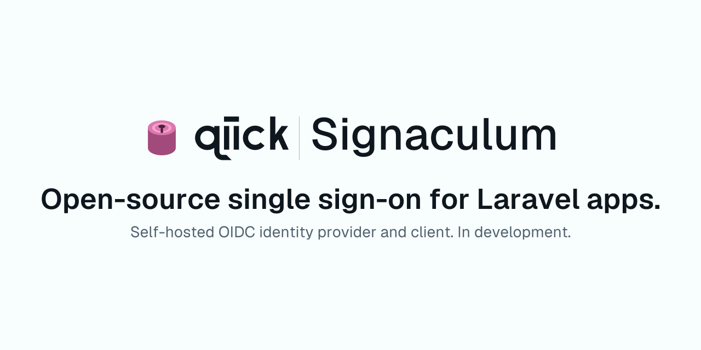

<p align="center">
  <picture>
    <source media="(prefers-color-scheme: dark)" srcset=".github/assets/header-dark.svg">
    <source media="(prefers-color-scheme: light)" srcset=".github/assets/header-light.svg">
    
  </picture>
</p>

# Signaculum

[](./LICENSE)
[](./composer.json)
[](./composer.json)

**Version:** `1.0.0-beta.1` (from `composer.json`; mirrored in `package.json`). See [CHANGELOG.md](./CHANGELOG.md).

> **Status:** `v1.0.0-beta.1` — first public beta. Fine for evaluation and wiring qiick apps; not a hardened production IdP. An external security review is planned before **1.0.0**. Header images are **placeholders** until swapped from the knowledge brand kit (see [.github/assets/README.md](./.github/assets/README.md)).

**Signaculum** is the optional, open-source, self-hosted **OpenID Connect identity provider** of the [qiick](https://qiick.io) suite. It gives qiick apps such as Externa and Excubia App single sign-on with organisations and roles, and it is the identity layer of qiick Cloud.

Every qiick app keeps working standalone with local login. Signaculum is one standard IdP among others (Keycloak, Zitadel, Authentik, Entra ID, …). On the app side, the generic client [`qiick/laravel-oidc`](https://github.com/qiick-io/laravel-oidc) works with any of them.

| | |
| --- | --- |
| **Install** | `composer create-project qiick/signaculum-core` · [Install](./docs/install.md) · [Upgrade](./docs/upgrade.md) |
| **OIDC** | [Protocol profile](./docs/oidc-profile.md) · [Clients](./docs/clients.md) · [Organisations](./docs/organizations.md) · [Keys & backup](./docs/key-rotation-and-backup.md) |
| **Security** | [SECURITY.md](./SECURITY.md) |
| **Issues** | [GitHub Issues](https://github.com/qiick-io/signaculum-core/issues) |

## What you get

- Local accounts: email and password, TOTP two-factor, passkeys, email verification
- Organisations with members and roles `owner`, `admin`, `member`, `billing` (multi-role; never zero owners)
- OpenID Connect on Laravel Passport: authorization code + **PKCE S256** (required), RS256 `id_token`, discovery, JWKS with rotation, userinfo, RP-initiated and back-channel logout, token revocation and introspection, optional client credentials
- Scopes `openid`, `profile`, `email`, `qiick.orgs` (`orgs` claim), plus `amr` / `acr` for MFA signalling
- Admin screens for users, OIDC applications, activity log and instance settings
- Self-registration **off by default** (closed IdP); instance admins enable it under Settings → Authentication & security

Not in v1: SAML, SCIM, IdP-initiated login, dynamic client registration, social logins, front-channel logout.

## Requirements

| Requirement | Notes |
| --- | --- |
| **PHP 8.4+** | `.php-version` / `composer.json` |
| **Composer 2** | |
| **Node.js 24** | `.nvmrc` |
| **Database** | SQLite (default); MySQL 8 or PostgreSQL 17 supported |

## Quick start

```bash
composer create-project qiick/signaculum-core my-signaculum
cd my-signaculum
nvm use
php artisan signaculum:install
```

`create-project` only copies `.env` and generates `APP_KEY`. **Finish with `signaculum:install`** (migrate, Passport keys, signing key, first admin).

> **Install only — not the update channel.** After the first tree exists, put new code in place and run `php artisan signaculum:upgrade`. Do not run `create-project` again. Details: [Upgrade](./docs/upgrade.md).

Non-interactive: `php artisan signaculum:install --no-interaction --force`.

### Docker

```bash
docker compose up --build
# http://localhost:8080 · GET /health/live · GET /health/ready
docker compose exec signaculum php artisan signaculum:install --no-interaction --force --no-npm
```

GHCR images (`ghcr.io/qiick-io/signaculum-core`) publish on `v*` tags after the maintainer releases.

### Connect an app

1. Admin → Applications: create a confidential (or public) client, copy the secret once, register redirect / post-logout / back-channel URIs — [Clients](./docs/clients.md).
2. On the Laravel app:

```bash
composer require qiick/laravel-oidc
php artisan oidc:configure --issuer=https://your-signaculum.example --client-id=... --client-secret=...
```

Add scope `qiick.orgs` when the app needs organisation roles. Protocol details: [OIDC profile](./docs/oidc-profile.md).

## Development

```bash
composer setup
composer test                                    # Pint, PHPStan, Pest
npm run lint && npm run types && npm run build
```

Local site: [Laravel Herd](https://herd.laravel.com) at `https://signaculum-core.test`. See [CONTRIBUTING.md](./CONTRIBUTING.md).

### Required checks (maintainer)

The list Luca should set on `develop` and `main` is in [docs/required-checks.md](./docs/required-checks.md) (`ci`, `pr-title / commitlint`, `app-ui-drift / standards`, `php-quality / php-quality`, `ui-quality / ui-quality`, `migrations-frozen / migrations-frozen`, `distribution-smoke / smoke`).

## License

MIT — see [LICENSE](./LICENSE).
